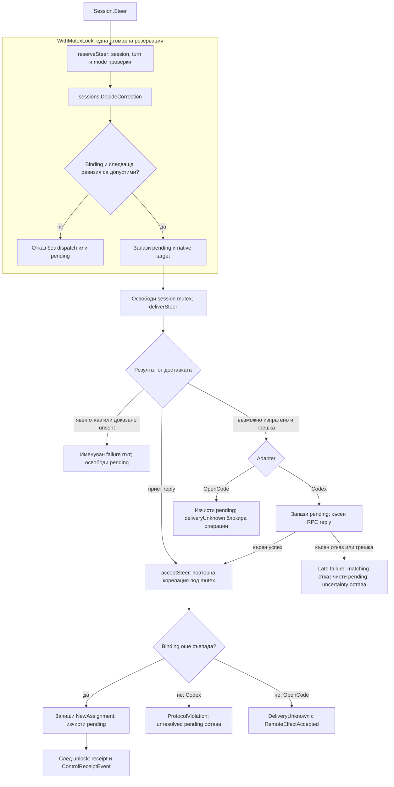

# Steer DDD пилотът: активна корекция и последващите поправки

Пилотът отделя общото правило за ревизия от процедурите за доставка в Codex и OpenCode. Всеки adapter запазва собствените си native проверки, резервация, приемане и reconciliation. Последващата одобрена корекция проверява Codex session handle, премахва разминаването между result candidate и event envelope и уеднаквява Codex native rejection политиката. Mutex wrapper-ът вече покрива всички production mutex участъци в harness инфраструктурата.

Текстът следва кода на 2026-10-02, след тези поправки. Това е ограничен пилот и последващ harness refactor; няма ново CLI свързване, persistence, provider integration или доказателство, че моделът е приложил поправката. Финалният преглед на всички ръчно написани production Go пакети е в [whole-code duplication audit](whole-code-duplication-audit.md).

## От факти до доставка

`internal/sessions` притежава `AssignmentRef`, неговите Conduit идентичности и чистото `DecideCorrection`; `provider` пази съвместимостта чрез aliases. Правилото изисква същата идентичност, съвпадащи current assignment и ExpectedRevision и точно следващата ревизия. `4 → 5` е допустимо; `4 → 6` и преливане от максималния `uint64` са отказ. Adapter-ите разклоняват по `Kind`, а `Reason` е обяснение за човека.

Диаграмата събира двата adapter-а; точният ред на ранните проверки е различен. Фактите, решението и резервацията остават в една критична секция. Steer delivery е извън session mutex. Това предпазва от конкурентна резервация, но не може да отмени вече изпратена команда.

Codex изпраща `turn/steer` с thread и expected native turn ID. RPC корелира request ID; acceptance проверява pending request и active turn. Cancellation след възможен dispatch оставя pending за късния reply. Валиден късен успех може да придвижи assignment и да публикува receipt след връщането към първоначалния caller. `sent` означава предаване към owned writer, а не доказано native acceptance.

OpenCode изпраща `session.prompt` с `delivery: steer` към serialized session lease. След приет receipt проверява lease и ревизията отново. При променен binding не придвижва assignment, но признава вече приетия remote ефект. При uncertain delivery `deliveryUnknown` блокира нови StartTurn и Steer; няма Codex-подобно късно RPC reconciliation.

## Трите поправки и общата синхронизация

Codex `reserveSteer` вече използва `checkSessionReference` вътре в атомарната резервация. Иначе валидна заявка към чужд handle връща stale binding, без dispatch, pending или промяна на assignment.

`emitEvent` е единственият Codex път за изграждане и публикуване на събития. Под `eventMu` взема един `eventBinding` snapshot под session mutex, след което освобождава session mutex. Result candidate и envelope използват същите captured turn, native IDs и assignment; candidate използва и captured contract. Builder-ът повторно проверява native корелацията и enforcement спрямо тези факти. При pending Steer и двете attribution стойности липсват; последващо reserve или accept между snapshot и publication не може да ги раздели. Подредбата остава `eventMu → session mutex`; broker publication се случва след освобождаване на session mutex.

`classifyDeliveryFailure` споделя Codex политиката между StartTurn и Steer. Явен native RPC отказ дава `delivery_rejected`, `RetryNever`, `RemoteEffectNotSent` и оригиналния Cause. Транспортна uncertainty остава `delivery_unknown`; cancellation и deadline запазват собствените си кодове и possibly-sent/reconcile metadata. Освобождаването на start/steer pending и late correlation остават в процедурите на съответната операция.

`WithMutexLock` извиква задължителен синхронен callback точно веднъж и освобождава mutex чрез `defer`, включително при panic; error и panic се предават без retry/recovery. Използва се в Codex session/normalization/RPC, OpenCode session/normalization/Steer и event broker. Единствените production `Lock/Unlock` извиквания са реализацията на wrapper-а. Broker остава bounded и single-subscriber: Publish не блокира, send и close са защитени от същия mutex, а buffered events предхождат terminal error.

## Маршрут за четене и критични места

1. [Одобреният договор](/Users/martinandreev/Projects/open-source/conduit-go/conduit-go/specs/002-steer-ddd/spec.md), [AssignmentRef](/Users/martinandreev/Projects/open-source/conduit-go/conduit-go/internal/sessions/assignment.go:12) и [DecideCorrection](/Users/martinandreev/Projects/open-source/conduit-go/conduit-go/internal/sessions/correction_rule.go:24) определят обхвата и прехода.
2. [Codex.Steer](/Users/martinandreev/Projects/open-source/conduit-go/conduit-go/internal/harnesses/codex/steer.go:13) и [OpenCode.Steer](/Users/martinandreev/Projects/open-source/conduit-go/conduit-go/internal/harnesses/opencode/steer.go:12) са flow owners; [Codex reservation](/Users/martinandreev/Projects/open-source/conduit-go/conduit-go/internal/harnesses/codex/steer.go:80) показва новия session guard.
3. [Codex failure classification](/Users/martinandreev/Projects/open-source/conduit-go/conduit-go/internal/harnesses/codex/delivery_failure.go:17), [Steer failure](/Users/martinandreev/Projects/open-source/conduit-go/conduit-go/internal/harnesses/codex/steer.go:118) и [StartTurn failure](/Users/martinandreev/Projects/open-source/conduit-go/conduit-go/internal/harnesses/codex/session.go:475) разделят споделената политика от state ефектите.
4. [Event snapshot](/Users/martinandreev/Projects/open-source/conduit-go/conduit-go/internal/harnesses/codex/event_binding.go:19), [emitEvent](/Users/martinandreev/Projects/open-source/conduit-go/conduit-go/internal/harnesses/codex/session.go:417) и [candidate construction](/Users/martinandreev/Projects/open-source/conduit-go/conduit-go/internal/harnesses/codex/normalize.go:199) показват единното attribution.
5. [RPC call](/Users/martinandreev/Projects/open-source/conduit-go/conduit-go/internal/harnesses/codex/rpc.go:84), [OpenCode Prompt](/Users/martinandreev/Projects/open-source/conduit-go/conduit-go/internal/harnesses/opencode/control.go:68), [mutex wrapper](/Users/martinandreev/Projects/open-source/conduit-go/conduit-go/internal/harnesses/internal/lockscope/mutex.go:10) и [broker](/Users/martinandreev/Projects/open-source/conduit-go/conduit-go/internal/harnesses/internal/eventstream/broker.go:39) са техническите граници.

Най-чувствителни са атомарната резервация, запазването на uncertain pending и единият candidate/envelope snapshot. Разделянето на check и mutation в различни lock scopes отваря race; изчистването на uncertain pending може да позволи повторна доставка. Receipt publication не е атомарно с assignment mutation и успешният return не доказва прочитане от consumer.

Разширеният wrapper refactor запазва наследени lock lifetimes, а не препроектира ресурсите. OpenCode StartTurn още извиква NewID и Launcher.Start под session mutex; Close приключва broker-а под него, а ObserveState извиква clock callback вътре. Отстраняването на блокиращото стартиране би изисквало отделно договорена reservation/lifecycle промяна. Event serialization mutex-ите остават около construction/publication; session mutex-ите не се държат при Steer transport. В Codex ObserveState clock callback вече е след snapshot unlock; RPC late callbacks и доставката до чакащите са извън pending mutex.

Receipt означава transport acceptance, не semantic acceptance. Codex result candidate остава недоверен. OpenCode не издава candidate в този slice и запазва текущ assignment attribution при unknown delivery; това ограничение не е променено.

## Проверки и граници на доказателствата

Rule тестовете покриват идентичност, stale facts, точно `+1`, equal/lower/skipped revision и overflow. Съществуващите adapter тестове покриват конкурираща резервация, cancellation, uncertainty, mismatched receipt и late reconciliation. [Новите regression тестове](/Users/martinandreev/Projects/open-source/conduit-go/conduit-go/internal/harnesses/codex/duplication_followup_test.go:16) проверяват чужд session без dispatch/reservation, детерминистично reserve/accept между snapshot и publication с еднакво candidate/envelope attribution и native rejection през самите StartTurn и Steer с пълен ProviderError. Това допълва историческите direct failure-subprocedure тестове с scripted RPC доказателство. [Lock-scope тестовете](/Users/martinandreev/Projects/open-source/conduit-go/conduit-go/internal/harnesses/codex/lock_scope_test.go:12) проверяват callback границите; wrapper тестовете покриват success/error/panic и непроменен panic payload.

За текущите broker/OpenCode промени implementation агентът изпълни успешно `GOCACHE=/tmp/conduit-locks-go-cache go test -race ./internal/harnesses/internal/eventstream ./internal/harnesses/opencode`. След приключването на всички кодови промени другият implementation агент изпълни успешно focused race, пълни CGO0 tests, vet, build и CLI help от реалното repo. Независимият whole-code reviewer лично повтори `go test -race -count=1 ./internal/harnesses/... ./internal/sessions/...`, `CGO_ENABLED=0 go test -count=1 ./...` и `go vet ./...` успешно; nested generator module също компилира. Пълната suite включва реални Turso операции върху временни локални бази. Snapshot manifest-ът в [доклада](whole-code-duplication-audit.md) идентифицира проверените 70 Go файла.

[Първият audit](audit.md) и [correction audit](audit-correction.md) са исторически прегледи на по-ранни snapshots. Посоченият тогава session-handle проблем вече е поправен. Текущият whole-code audit потвърждава трите одобрени поправки и отделя новите препоръки: грешен operation при unsupported Steer input в `codexInputs`, наследен OpenCode launch под mutex, потенциална check/emit корелация извън candidate path, ръчно schema knowledge, journal decoding и въпрос за domain identity. Тези находки не са автоматично поправени или представени като приети решения.

Обикновеният full suite среща предшестващ Turso/macOS SDK linking failure; текущите пълни проверки са с CGO disabled. Няма live model, remote Turso или production проверки, нито Windows runtime доказателство. Докладът е консултативен, не решение за приемане или доказателство за пълна коректност.
