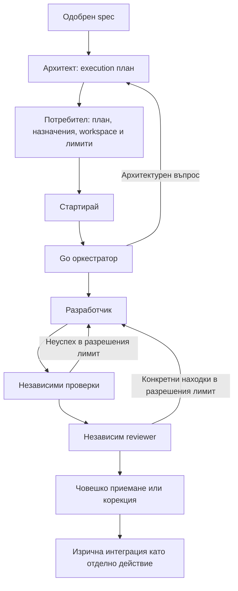

# Архитектът планира, Go оркестраторът изпълнява

Дата: 2026-10-03. Статус: **одобрена архитектурна и продуктова посока**. Това не разрешава имплементация преди конкретна task група и договорени технически граници.

## Разпределение на отговорностите

- Архитектът съставя execution плана и решава архитектурните неясноти. Не ръководи всяко рутинно dispatch решение чрез нов model call.
- Go оркестраторът изпълнява одобрения план чрез rules/procedures: проверява готовност, стартира допустими задачи, следи зависимости, записва наблюденията и спазва ограниченията. Не измисля нов обхват или архитектура.
- Разработчикът реализира възложената задача. Независими проверки и reviewer оценяват резултата. Човекът приема крайния резултат.

## Одобрен flow

1. От одобрен spec архитектът подготвя задачи с очакван резултат, зависимости, файлов обхват, проверки и необходима роля. Промяна на spec се връща за обсъждане.
2. Conduit предлага назначения от настройките на ролите. Потребителят вижда и може да промени harness/model. Липсващо назначение се показва; няма автоматичен платен fallback.
3. Потребителят преглежда плана, назначенията, branch/workspace и лимитите в подготовката. „Стартирай“ разрешава този обхват; няма задължително отделно потвърждение за всяка рутинна задача.
4. Go оркестраторът изпълнява плана. При архитектурна неяснота се обръща към архитекта; промени извън разрешеното не се изпълняват мълчаливо.
5. Промените минават през независими проверки и review агент. Отчетът „готово“ от разработчика не е доказателство за успешни проверки.
6. Човекът вижда резултатите, findings и критичните места, след което приема или иска корекция. Приемане, cleanup и commit/merge имат отделни резултати. Интеграцията в основния branch е изрично действие.

Стрелките за корекция обозначават политика в разрешен бюджет, не безкраен retry loop. Връщането към архитекта не позволява автоматично стартиране на променен план без съответното одобрение.

## Корекции и нужда от решение

| Ситуация | Одобрена посока |
| --- | --- |
| Уточнение в текущия обхват при активен turn | Steering с нова assignment revision, точно +1 |
| Промяна на обхвата/архитектурата | Архитект и ново одобрение на засегнатия план |
| Неуспешна проверка или конкретна review находка | Корекция към отговорния разработчик в предварително разрешения лимит |
| Изчерпан лимит, противоречие или неизвестна доставка | Не стартираме нови зависими действия; показваме какво решение липсва |

След завършен turn корекцията изисква ново възлагане, чийто attempt/session договор предстои. Не я представяме като Steer към несъществуващ active turn. Неизвестната доставка не разрешава автоматично повторение на външния ефект. Спирането на нови действия не твърди, че вече започналите са прекратени.

## Първа реализация

Последователно изпълнение: един разработчик в изолиран workspace, после проверки и независим reviewer. Няма едновременни code writers. Планът може да представя зависимости още отначало. Паралелната работа се проектира отделно след ownership и integration договор. Макетите с няколко роли са визуален контекст, не изискване всички да работят едновременно.

## Нерешени технически детайли

- Точни task/plan DTOs, връзка към spec версия и атомарно одобрение/стартиране.
- Workspace създаване, ownership/fencing, проверяван snapshot и cleanup.
- Числови бюджети, лимит за корекции и реакция при една и съща повтаряща се находка.
- Версии на назначенията, capabilities и промяна на конфиг при активна работа.
- Редът на проверките при частични провали; reviewer контекстът и гаранциите за независимост.
- Нов attempt срещу продължение, stop/recovery, persistence и failure paths.
- Механизмът за окончателна Git интеграция. Този договор не разрешава commit/merge автоматично.

Следващото обсъждане е конкретният execution план като договор. Едва след техническото уточняване се създава одобрена implementation група със сценарии за верификация.

## Възлагане и проектна памет

[Контрактът за възлагане](agent-assignment-context.md) уточнява трите слоя проект/feature/task и проследимия контекст към агента. [Проектната памет](../../004-project-navigation/contracts/project-memory.md) отделя автоматичната фактическа история от преглежданите бележки/решения и заменяемия индекс. Конкретните schemas и memory продукт още предстоят.
