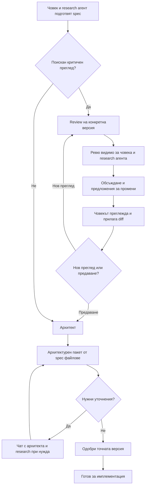

# Подготовка на spec с research и критичен review агент

Статус: договор в процес на обсъждане; потвърдените решения са отделени от предложенията. Не разрешава имплементация.

## Потвърдени продуктови решения

- Човекът може сам да започне и редактира spec, както и да обсъжда и доразвива части с лек research агент още при подготовката му.
- „Обсъди“ връща отговор без промяна по документа. „Предложи промяна“ предоставя diff за приемане, редактиране или отхвърляне от човека.
- Визуалната посока е проекти, документ и разговор в отделни панели; за тесен TUI — адаптивно показване. Точните клавиши и контроли предстоят.
- Има възможност за добавяне на песимистичен review агент преди предаването към архитекта.
- Ревюто е достъпно и за човека, и за research агента, за да могат да обсъдят находките и да коригират spec файла.

## Директно писане и запис — последващо уточнение

„Нова идея“ отваря редактора с показваем/скриваем страничен чат; няма отделна начална форма или избор „пиши сам/с агент“. Разговорът се запазва при скриване, а показването само по себе си не изпраща заявка към модел. Налични са бутон „Запази“ и автоматичен запис на няколко секунди. Конкретните shortcut, интервал и default режим предстоят след зададения въпрос към потребителя.

Преди имплементация трябва да се уточнят първият запис/път на нов документ, външни редакции, отказ при запис и напускане с незапазени промени. Автоматичният запис на вече приложен текст не означава автоматично приемане на предложенията на агента. [Макет на редактора](../../004-project-navigation/screens/04-new-idea-v2.png).

## Предложен flow

Диаграмата предлага изрични човешки действия; не въвежда автоматичен цикъл, допълнителни model calls или задължителен успешен review gate. Критериите за предаване предстоят.

## Роля на песимистичния reviewer — предложение

Търси конкретни пропуски: противоречия, скрити предположения, неясен обхват, непроверими критерии, пропуснати failure сценарии и рискови зависимости. Описва сценария, последствието и доказателството/основанието, вместо да произвежда критика заради самата критика. Неопределеностите са въпроси, не измислени дефекти.

Предлагаме reviewer да връща отделен артефакт и да не редактира spec директно. Research агентът използва находките като контекст и предлага diff; човекът решава кои промени да приложи. Различна препоръка или несъгласие остава видимо.

## Предложен договор за ревюто

Вход: project/document identity, конкретна версия или snapshot на документа и явно предоставени материали. Изход: кратко summary и findings със стабилна идентичност, важност, секция, проблемен сценарий, последствие, основание и препоръка/въпрос.

Ревюто остава свързано с прегледаната версия. След редакция не се представя като проверка на новия текст. Предложени означения за находки: отворена, адресирана с промяна, неприложима с обяснение. „Адресирана“ не означава повторно проверена от reviewer. Точните статуси и кой може да ги задава ще се съгласуват.

## Предложение за UI/TUI

До „Документ“ и „История“ има изглед „Ревю“. В него се виждат версията, findings и свързаните секции. Избор на finding показва съответния текст; „Обсъди с research агента“ добавя finding и неговия контекст към разговора. Research агентът трябва да може да получи целия review артефакт, не само видимата на екрана находка. Предложените корекции използват същия diff flow като останалите редакции.

Предаването към архитекта предлага пакет с избраната версия на spec, ревюто и отговорите/оставащите въпроси. Няма мълчаливо скриване на неприети препоръки.

## Отворени решения

- Под „план“ преди архитекта разбираме работния spec/продуктов замисъл; ако има отделен документ с план, неговата роля трябва да се уточни.
- Дали ревюто е само съветващо, или определени findings трябва да блокират предаването? Предложение: съветващо, с изрично човешко решение.
- Модел, бюджет, достъп до репото/външни източници и независим контекст на reviewer.
- Изрично ли се стартира повторен преглед и как се избира обхватът му? Предложение: без автоматичен review/correction loop.

## Визуални ориентири

[Галерията с макети](../screens/README.md) съдържа desktop подготовка на spec, същия flow в TUI и TUI критичен преглед с предложена корекция. Изображенията са локални за репото и служат за дизайн обсъждане; не заменят договореното поведение.

Допълнителни [макети 04–05](../screens/README.md#04--редактор-със-скрит-чат) показват скрития чат и предложена настройка на асистент. Отделният diff екран 06 е премахнат от активния flow. Новите визуални детайли са за обсъждане; не фиксират model каталог, цена, default избор или разрешение за inference.

## Прилагане на предложения и следващ етап

Потвърдено: „Приложи“, „Редактирай“ и „Отхвърли“ са към предложението в чата. „Виж промените“ отваря diff в документния панел. Няма отделен задължителен diff екран. „Запази“ е действие на документа и не се слива с прилагането на предложение.

След подготовката следва [архитектурно доразписване и одобрение](architecture-refinement.md): архитектът прочита целия spec, оркестрира research за факти и създава архитектурен пакет според детайлността. Човекът може да чете и уточнява чрез чат или директно да одобри готовия пакет за имплементация.
