# Визуални ориентири

Дата: 2026-10-03. Генерирани концептуални макети от продуктовото обсъждане, запазени в репото като ориентир за дизайна. Не са screenshots на работеща имплементация. Основният [договор за подготовка на spec](../contracts/spec-authoring.md) определя потвърденото поведение и отворените решения; макетите не утвърждават допълнителни правила чрез показаните примерни данни, клавиши, версии или контроли.

Одобрена визуална посока — 2026-10-03: екрани 07 „Архитектът работи“ и 08 „Преглед и одобрение на архитектурния пакет“. Те служат като ориентири при бъдещ визуален одит за разположение и flow, не за буквално копиране на примерни данни и генеративни артефакти. Екран 06 остава отпаднал; действията по предложенията са в чата.

## 01 — Desktop: документ и research агент

Проекти вляво, редактируем spec в средата и разговор вдясно. Маркирана секция дава контекст на разговора. Агентът предлага промяна за изрично прилагане, редакция или отхвърляне.

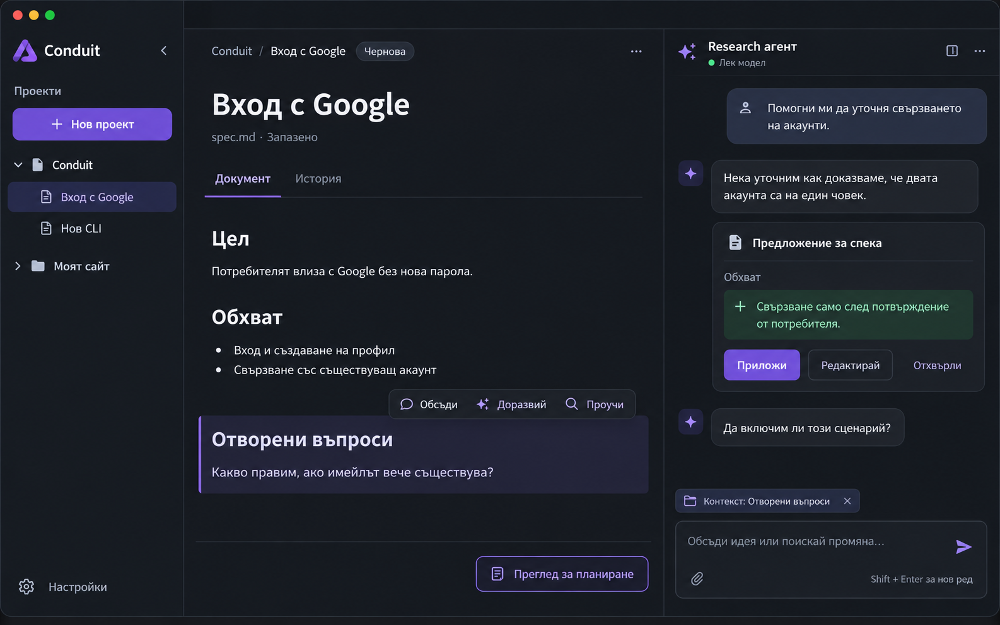

## 02 — TUI: подготовка на spec

Същият сценарий в широк терминал: Markdown документ, разговор и ясно показан активен панел. Долният ред показва примерни клавишни действия. При тесен терминал панелите се адаптират; макет 13 по-долу показва предложението с един видим панел.

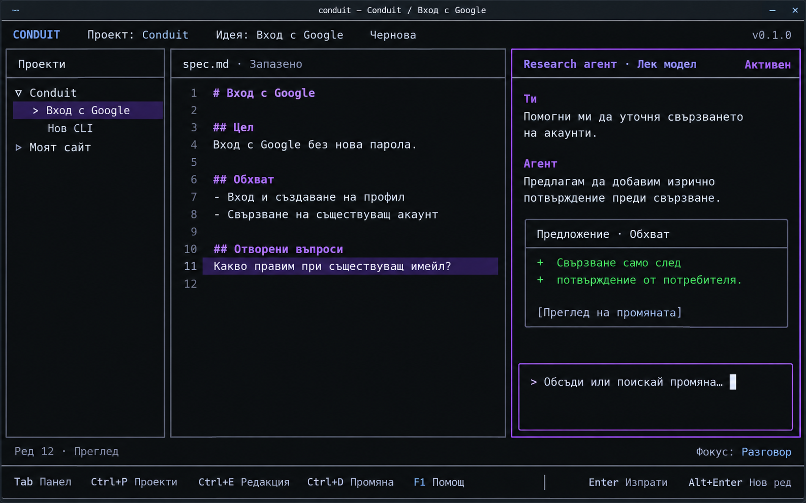

## 03 — TUI: критичен преглед и корекции

Изглед „Ревю“ показва находките, прегледаната версия и засегнатата секция. Research агентът има достъп до ревюто и предлага diff по избрана находка. Човекът решава за промяната. Предаването към архитекта е отделно действие; изображението не решава дали находки блокират предаването.

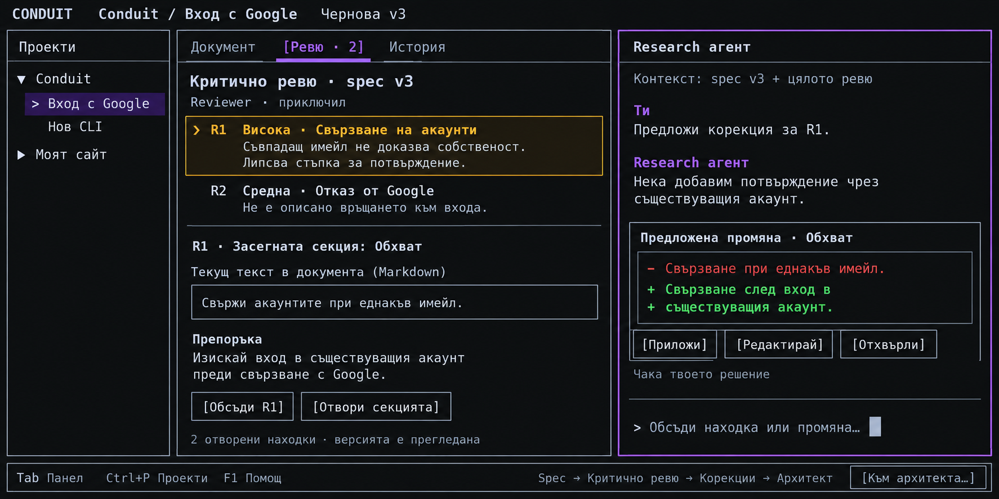

## Поддържане на ориентирите

Следващи обсъждани макети се добавят тук с описание на сценария и връзка към съответния договор. При промяна на дизайна се запазва ясна версия и се обозначава кой макет е заменен. Снимките служат за обсъждане; противоречие с договора се уточнява преди имплементация.

## Предходни екрани във flow-а

[Първо стартиране и начален екран на проект](../../004-project-navigation/screens/README.md) показват входа към този flow. Новите макети са предложения за обсъждане. За реално имплементирани екрани използваме проектния `tui-visual-audit` skill.

## 04 — Редактор със скрит чат

Документът заема освободената ширина. „Покажи чата“ връща разговора; скриването запазва историята и не означава команда за спиране на агент. Има „Запази“ и видим статус за незапазени промени. Автозаписът е поискан, но интервалът и shortcut поведението чакат отговор; този макет не определя default.

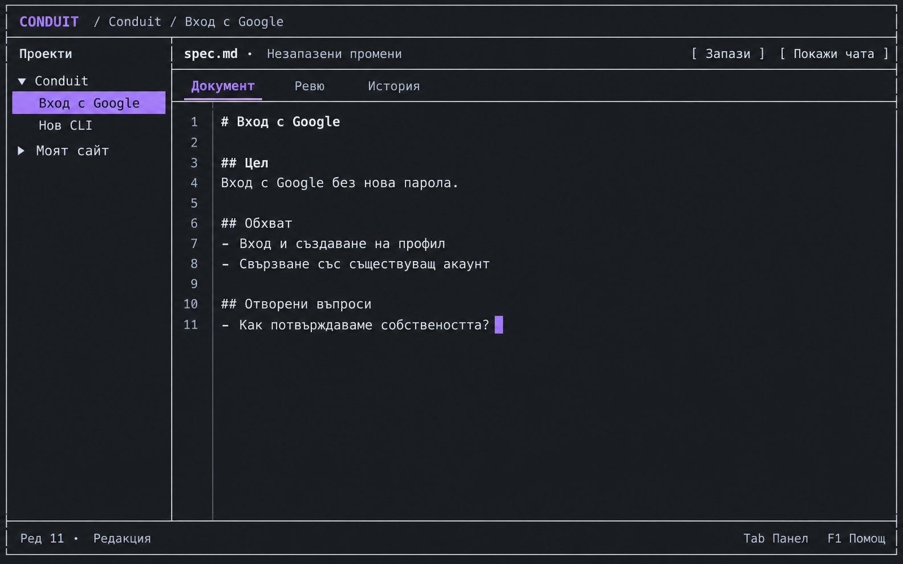

## 05 — Избор на асистент

Предложение: отделен избор на harness и модел за разговора. Имената Luna/Sol са примерни UI данни, не актуален списък или обещание за достъп/цена. Реалният каталог, capabilities, състоянията при липсващ harness/достъп и scope на запазения избор предстоят. Модел не се стартира само при избор; изпращането на съобщение е отделно действие. Настройката не е prerequisite за самостоятелно писане.

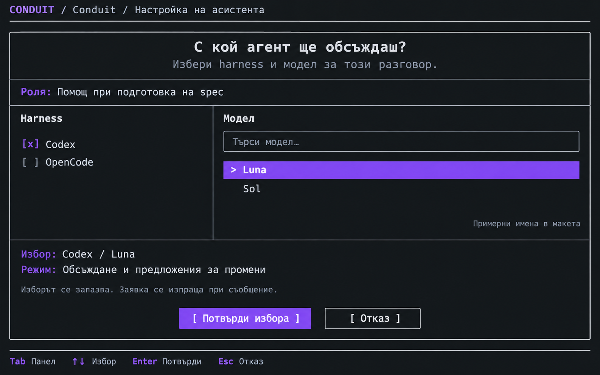

## 06 — Отпаднал отделен diff екран

По решение на потребителя този екран не участва в flow-а. Действията са в чата, а diff се вижда в документния панел. [Старият макет](archive/06-proposal-diff-superseded.png) е само архив.

## 07 — Архитектът работи

Архитектът чете целия spec, възлага проверки на research подагенти и пише решението. Макетът показва наблюдавана активност и разговор за уточнения; етапите, часовете и резултатите са примерни данни. Няма процент, гаранция за качество или кодова имплементация. Детайлността „Подробна“ е пример, не финализиран набор от нива.

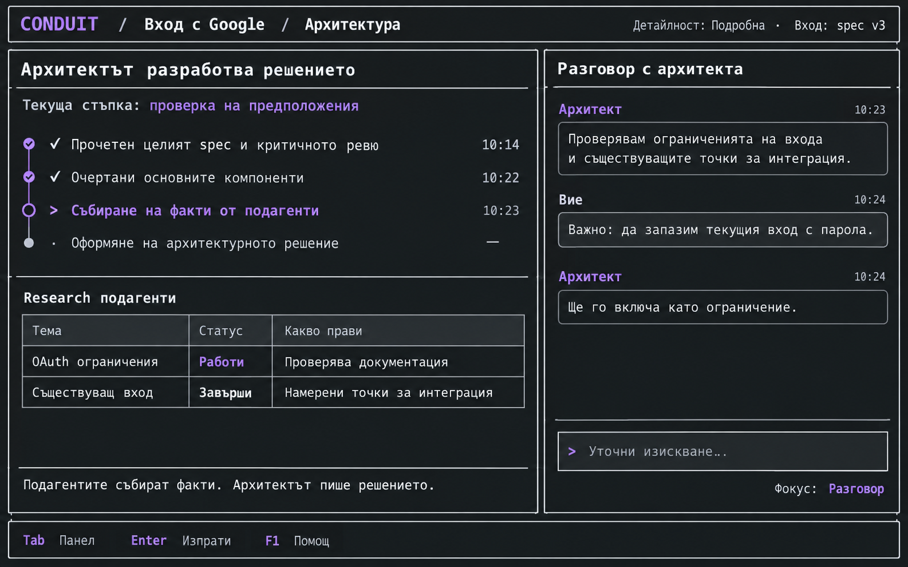

## 08 — Преглед и одобрение на архитектурния пакет

Файлове вляво, документ в средата и скриваем чат с архитекта вдясно. Прилагането на предложена корекция е в чата. Потребителят може да продължи уточняването, включително с ново research, или директно да одобри записаната версия. Одобрението маркира готовност за имплементация, без да я стартира.

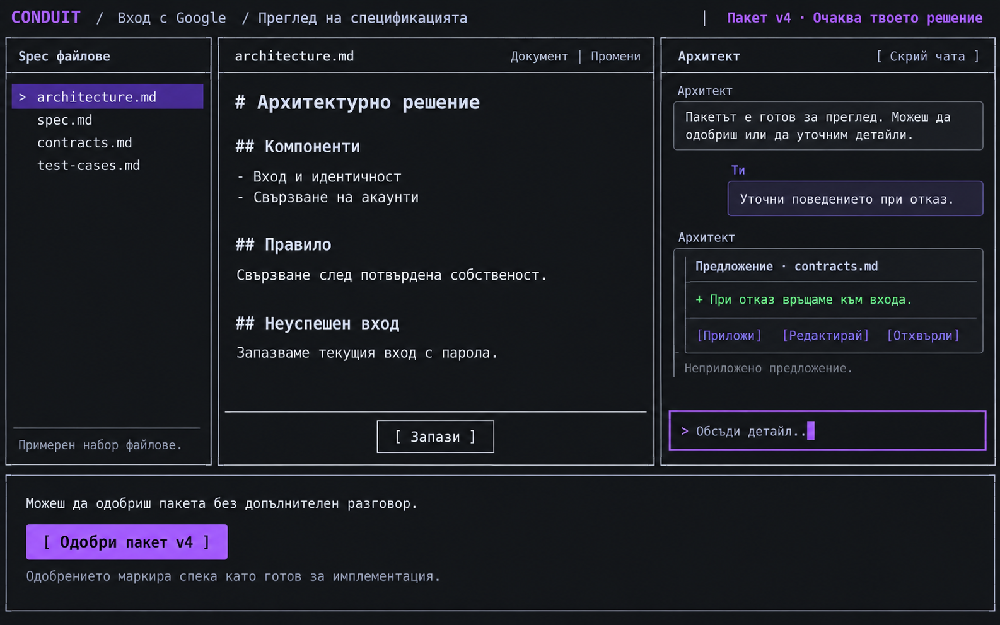

Показаното неприето предложение не е част от пакет v4. Точният flow при незапазени промени и правила за критични findings предстоят в [договора](../contracts/architecture-refinement.md). Макетът не разрешава мълчаливо одобрение на променящ се пакет.

Точните клавиши, декоративните акценти и примерните имена/версии не са нормативни. Реалният TUI различава един keyboard focus от селекция и primary action. Остават за дизайн: липсващ harness, save/conflict errors, тесен терминал и execution flow.

## 09 — Подготовка на имплементацията

Одобреният spec е вход към отделен старт. Макетът предлага план с задачи, роли и зависимости, преглед на назначения, workspace и лимити. Примерът показва липсващи настройки и недостъпен старт с причина. Графът и екипът са продуктово предложение за по-широк flow; одобреният минимален smoke с един агент не разрешава автоматично scheduler или паралелни writers.

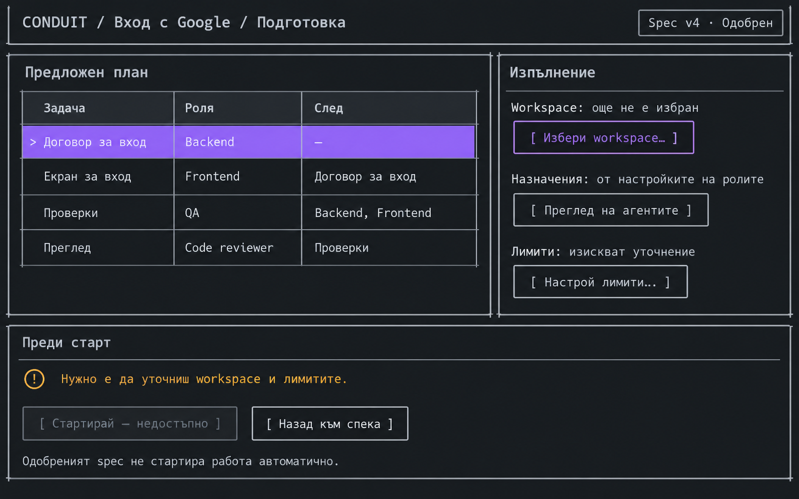

## 10 — Работа и steering

Избор на агент, наблюдавана активност/команди/файлове и разговор към конкретното възлагане. Receipt за revision 2 е отделен от доказателство за приложена корекция. Една успешна команда не е окончателно verification. „Поискай спиране“ не означава доказано native cancellation. Примерните код/лога в изображението са измислени данни за макета, не изпълнени проверки или код за копиране.

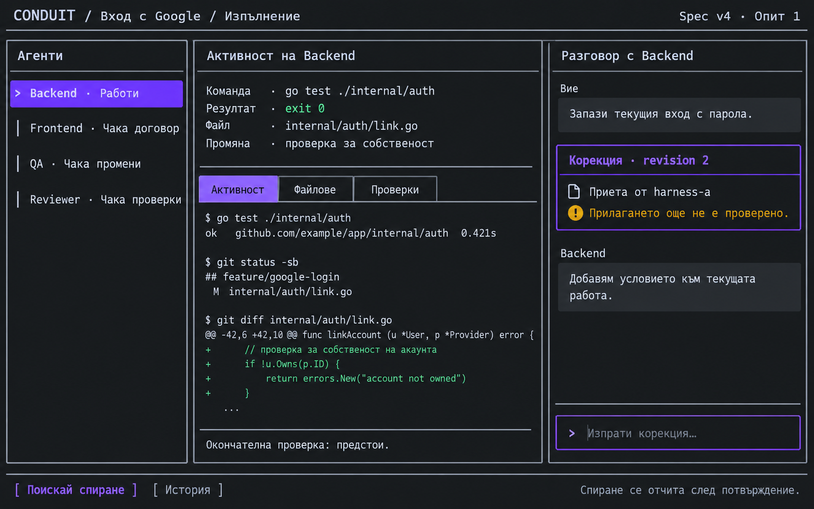

## 11 — Проверки, ревю и човешко приемане

Показва доказателства за конкретен candidate/revision/snapshot и човешко решение за приемане или корекция. Примерните зелени резултати не са реални тестове. Приемането на implementation резултат е различно от одобрението на spec; не прави commit/merge. Cleanup се отчита отделно. „Поискай корекция“ след завършен turn изисква договор за ново възлагане/attempt, не може да се третира автоматично като active Steer.

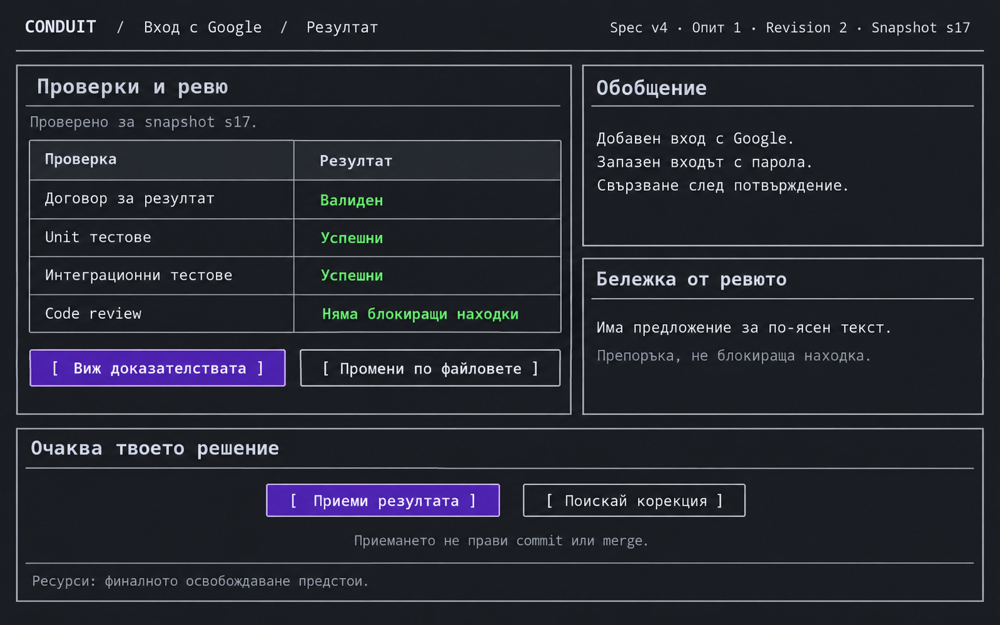

## 12 — Конфликт при запис

Предложение за случаите с едновременно външно редактиране: запазен локален buffer, явен конфликт и сравняване/копие без мълчалив overwrite. Показаното временно спиране на автоматичния запис е предложение при конфликт, не отговор на още нерешения default режим/shortcut. Няма cloud storage интеграция. Save failure без външна промяна е отделен сценарий, за който още няма макет.

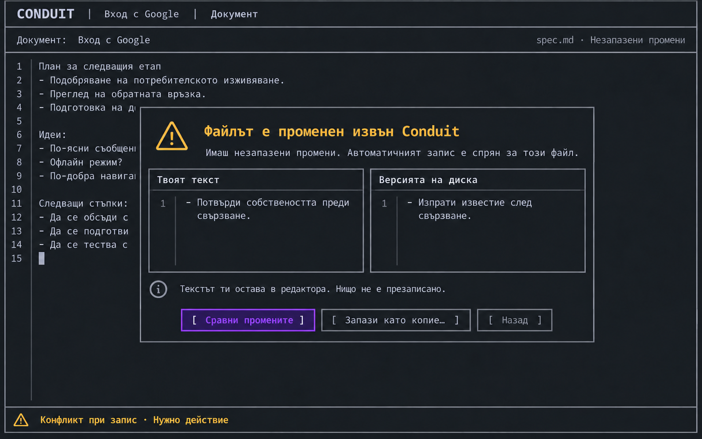

## 13 — Тесен терминал

Един основен панел с превключване между проект, документ, разговор и ревю. Предложенията и действията остават в чата; „Виж промените“ преминава към документа. Размерът на изображението не е точен breakpoint в терминални колони. Реалната resize/focus/scroll/input continuity трябва да се проверява с приложението.

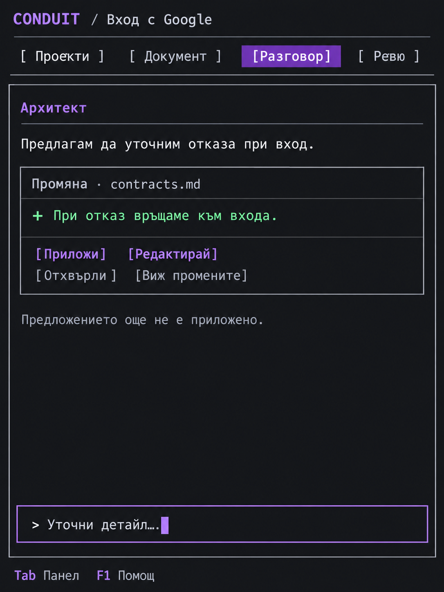

## Граници на новата група

Макети 09–13 са предложения за преглед, не одобрени implementation договори или изпълнени visual tests. Клавишите, броят роли, планът, лимитите и blocking политиките чакат съгласуване. Декоративните лилави акценти не означават повече от един keyboard focus.

Остава да уточним кой съставя/одобрява execution плана, workspace изолацията, назначаването на модели, лимитите, връщането за корекция, провалените проверки, неизвестна доставка/прекъсната сесия, recovery и Git интеграцията. Липсващ harness и конфликт са първи error примери, не пълно покритие на всички проблемни състояния.

## Последващо одобрение на execution посоката

На 2026-10-03 е прието разделението архитект-планиране / Go-изпълнение, с преглед преди стартиране и последователен първи вариант. [Execution договорът](../contracts/execution-orchestration.md) уточнява макети 09–11. Точната им подредба и илюстративните роли/лимити не стават автоматично финализиран UI договор.
