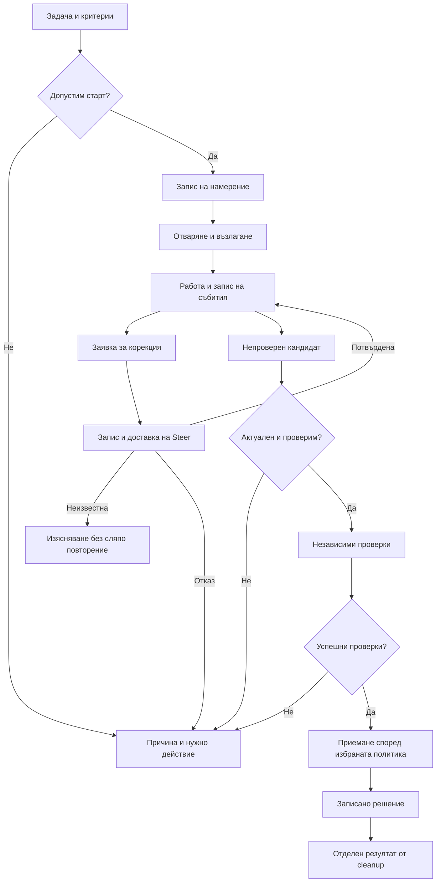

# Първи цялостен application flow

Статус: **проект за application flow; одобрен е само bounded smoke slice в края**. Дата: 2026-10-02. Изходна версия на кода: `b9abcde`.

Потребителят разреши да опишем сценария. Конкретните продуктови решения по-долу са предложения, освен изрично посочените установени граници. Не започваме имплементация от този документ. Имената на процедури, състояния и правила са работни; не определят автоматично Go пакети или публичен API.

## Цел и предложен обхват

Потребителят възлага конкретна задача, следи реалната активност на агента, може да изпрати корекция и получава резултат с независимо проверени доказателства. Историята обяснява какво е станало и какво решение се очаква от човека.

Предложение за първи вертикален сценарий: **една задача, един агент, една логическа сесия**, първо с fake harness. Повече от един последователен turn може да е необходим за поправка на резултат; това не означава паралелни агенти. Този минимален обхват е потвърден за smoke slice.

Потвърдено за smoke slice: Conduit проверява резултата, след което човекът го приема; тестът симулира отделното човешко действие. Автоматично приемане не е включено. Приемането не означава Git commit, merge или promotion.

Извън предложението са scheduler за граф от агенти, TUI/desktop, автоматична интеграция в основния branch, импорт на TypeScript базата, remote Turso и автоматично възстановяване на native сесия след рестарт.

## Установена основа и реални ограничения

- [Provider contract](../../internal/sessions/provider/README.md): адаптерът притежава native комуникацията; Conduit притежава assignment revisions, durable control intent, проверките и завършването.
- [Harness slice](../001-harness-storage/harnesses.md): има Codex/OpenCode, нормализирани събития, live Steer и изрично ограничени capabilities. Native receipt доказва transport acceptance, не изпълнение на корекцията.
- [Storage slice](../001-harness-storage/storage.md): локален Turso, session records с optimistic version и journal с per-run sequence. Има unit-of-work за session write и event append. Няма готови хранилища за задача, control intent, candidate, verification или human decision.
- [Архитектура](../../.agents/instructions/architecture.md): чисти правила с конкретни Kind/Reason; процедури управляват flow; стъпките имат един логически ефект; техническите wrappers не решават бизнес въпроси.
- Корекцията пази assignment identity и увеличава revision точно с 1. Това правило вече е установено.
- Codex може да излъчи корелиран candidate от доказан native final канал. Текущият OpenCode адаптер не излъчва ResultCandidate. Неговите текст, idle и process exit не могат да заместят този канал.
- CLI засега е scaffold. Няма application service, който свързва тези части в работещ сценарий.

## Сценарий от гледна точка на човека

1. **Подготовка.** Потребителят подава задача, обхват на позволените промени, workspace, критерии за приемане и предварително разрешени проверки. Conduit показва избрания harness и capabilities, липсващите изисквания и какво реално може да извърши.
2. **Старт.** След проверка на входа и правото за работа във workspace се записва намерението за стартиране. Отваря се harness сесия и се изпраща assignment. Потребителят вижда „стартира“, докато няма достатъчно наблюдение за активната работа.
3. **Наблюдение.** Activity изгледът показва съобщения, налични reasoning summaries, tools, команди, файлови операции и диагностични събития. Твърдение на агента и независима проверка се обозначават различно. Липсващ telemetry остава неизвестен; не се измисля мисловен процес или процент напредък.
4. **Корекция.** Потребителят изпраща промяна спрямо видимата revision. Conduit проверява актуалността, записва control intent и подава Steer. Изгледът различава „чака доставка“, „приета от harness“, „отхвърлена“ и „доставката е неизвестна“.
5. **Кандидат за резултат.** Полученият кандидат се записва като непроверен и се свързва с точния assignment/turn/revision. Стар или некорелиран кандидат не може да завърши текущата задача.
6. **Проверка.** Conduit валидира структурата, семантиката и приложимостта, после изпълнява одобрените независими проверки върху ясно идентифицирано състояние на workspace. Отделно показва твърденията на модела и наблюдаваните резултати.
7. **Решение.** При успешно проверен резултат следва избраната политика за приемане. При отказ се показват конкретни причини и допустими действия. Коригиращ turn/повторен опит е изрично решение; няма безкраен автоматичен retry.
8. **Приключване.** Решението се записва устойчиво. Освобождаването на ресурси има собствен резултат. Приет резултат с проблем при cleanup не се представя като безусловно успешно освободена сесия.

Диаграмата показва основния път. Следващите таблици определят проблемните случаи; стрелка към „нужно действие“ не означава непременно спиране на native работа.

## Състояния: отделни въпроси, не един общ status

Предлагаме отделни измерения, за да избегнем например „процесът приключи, значи задачата е успешна“.

| Измерение | Работни състояния | Какво отговаря |
| --- | --- | --- |
| Application задача | prepared, starting, running, verifying, awaiting_acceptance, accepted, failed, cancelled | Какво е постигнато по задачата? |
| Нужда от внимание | няма или структуриран reason с допустими действия | Кое решение липсва, без да заличава текущия етап? |
| Доставка на конкретна команда | recorded, dispatching, accepted, rejected, unknown | Какво знаем за външния ефект? |
| Проверка на кандидат | pending, passed, failed, blocked, superseded | За кой кандидат и revision важат доказателствата? |
| Ресурси/native execution | установеното от provider: active, quiescent или unknown според конкретното поле | Безопасно ли е освобождаване или нов писател? |

Това са предложени понятия, не финални enum-и. `accepted` в delivery не е `accepted` за задачата. `awaiting_acceptance` съществува само ако изберем човешка стъпка. `cancelled` не доказва спиране на външния процес.

| Преход | Необходим факт/решение | Устойчив запис |
| --- | --- | --- |
| prepared → starting | Валиден assignment, capabilities и workspace ownership | Intent преди външен старт |
| starting → running | Корелирано приемане/наблюдение на start | Binding и наблюдаван outcome |
| running → verifying | Приемлив кандидат с актуална attribution и подходящо състояние за проверки | Candidate identity, revision и evidence target |
| verifying → awaiting_acceptance | Всички задължителни проверки са успешни и още актуални | Verification report |
| awaiting_acceptance → accepted | Разрешен actor и точно същият проверен кандидат | Решение, actor, candidate/revision и evidence reference |
| текущ етап → нужда от внимание | Неизвестна доставка, gap, изгубена сесия, отказана проверка или capability | Причина и наблюдавани факти, без измислен outcome |

При автоматична политика последните два успешни прехода се заменят с проверено автоматично решение. Таблицата още не разрешава конкретна такава политика.

## Процедури и техните граници

| Предложена процедура | Чисти решения | Основни стъпки и резултат |
| --- | --- | --- |
| StartAssignment | Допустим ли е стартът при assignment, capabilities и ownership? | Запис на intent; OpenSession; StartTurn; запис на резултата |
| IngestProviderEvent | Отнася ли се събитието за този binding; повторено/несъвместимо ли е? | Redaction; journal append и свързан state update; известяване на читателите |
| SubmitCorrection | Валидни ли са expected revision и next revision; допустим ли е Steer? | Запис на intent; доставка; запис на receipt/rejection/unknown |
| EvaluateCandidate | От допустим източник ли е; актуален ли е; пълен ли е? | Запис на candidate и решение; при допустимост планиране на проверки |
| VerifyCandidate | Какви одобрени проверки са приложими и достатъчни? | Изпълнение на всяка проверка като отделна стъпка; запис на доказателства |
| AcceptResult | Покрити ли са критериите и избраната политика; непроменено ли е провереното състояние? | Атомарен запис на решение и свързано application събитие |
| RequestStop / CloseSession | Какво поддържа harness-ът и какво доказва quiescence? | Отделно stop/close действие, наблюдение и запис на известния outcome |

Окончателните имена, домейнни собственици и разполагането по Go пакети се съгласуват преди реализация. Сервизът ще предоставя тези операции, без второ копие на flow. Не е нужен общ Skeleton преди да имаме доказано обща последователност.

## Durable intent и външни ефекти

Предложен ред: **транзакция с intent → външен ефект извън транзакцията → транзакция с outcome**. Транзакция в Turso не може да върне назад стартиран процес или приета корекция.

- Външна команда носи application command ID и очаквана revision. Повторение със същия ID и различно съдържание се отхвърля; повторение със същото съдържание чете записания outcome, без автоматично повторно изпращане.
- След crash между intent и outcome приемаме, че ефектът може да е настъпил. Изясняването ползва доказани capabilities; ако няма достатъчно доказателства, остава unknown с действие за човека.
- Няма обещание за exactly-once доставка към harness. Локалната идемпотентност не доказва такава гаранция.
- Промяна на application state и съответното journal събитие трябва да се запишат заедно. Нужните нови ports/records/транзакции още не съществуват; не ги заместваме неявно с произволен JSON в session.State.
- Redaction се прави преди persistence. UI чете durable sequence; adapter cursor не е journal cursor. Събитие не се представя като устойчиво записано преди commit.
- При gap/overflow/storage failure историята се маркира непълна. Политиката за backpressure, спиране и продължаване изисква решение; няма мълчаливо изпускане на критични събития.

Точните command/event DTOs, deduplication key и schema changes ще са отделна част на бъдещия implementation packet. Това не разрешава пълен event-sourcing модел.

## Корекция и състезание с финален резултат

Държим отделно текущата съгласувана assignment revision и предложената pending revision. Не записваме предложената като успешно доставена само защото UI е изпратил командата.

1. Заявката носи command ID, current assignment, expected revision и предложение с точно +1.
2. Решението и резервирането са атомарни спрямо конкурентни application команди. DB CAS пази persistent version; native mutex пази adapter state. Нито едното само по себе си не замества другото.
3. При explicit rejection intent получава отказ; няма фалшиво advancement.
4. При accepted receipt се записва transport acceptance. Това още не доказва, че агентът е приложил корекцията; резултатът трябва да отговаря на актуалните критерии.
5. При unknown не изпращаме автоматично повторно и не завършваме задачата с предполагаема нова attribution.
6. Кандидат за стара revision се запазва като superseded/неприемлив за текущата задача. Кандидат без доказуема attribution не се привързва насила към последната revision.
7. Предложение: приемането и нова корекция се сериализират чрез една application version граница. Ако корекцията спечели, старият acceptance се отказва; ако acceptance спечели, късната корекция се отказва и потребителят избира нова задача. Тази конкретна продуктова политика чака одобрение.

## Проверка и приемане

Разделяме четири доказателства: допустим source и binding; валидна структура; семантично покритие на заданието; независимо наблюдавани резултати от разрешените проверки.

Проверки не се избират и изпълняват само по произволна команда в отговор на модела. Входният договор определя разрешени инструменти, workspace, ограничения и задължителни критерии. Skipped/blocked/unknown не са passed.

Verification report трябва да се свързва с точния candidate, assignment revision и workspace snapshot. Ако файловете се променят след проверката, старият зелен резултат не е достатъчен за приемане. Начинът за freeze/snapshot и гаранцията за един писател трябва да се проектират; не държим DB транзакция по време на тестове.

Предложение за feedback: конкретен Kind/Reason, кои критерии липсват, факти от проверките и допустима следваща стъпка. Автоматичен correction loop и неговият бюджет не са решени. За първия сценарий може да използваме изрично човешко решение за нов опит.

## Прекъсване и възстановяване

Отказът от чакане на RPC не доказва native cancellation. UI трябва да различава „поискано спиране“, „спирането е доказано“ и „изпълнението е неизвестно“. При OpenCode затварянето на локалния handle не означава спряна работа в shared service.

Предложение за първия slice: след рестарт показваме durable историята и недовършените intents за изясняване; не обещаваме автоматично resume. Нов писател за същия workspace не стартира, докато ownership и quiescence не са достатъчно доказани. Foreground срещу background lifecycle и recovery действията чакат решение.

## Проверими сценарии за бъдещата имплементация

| Сценарий | Очаквана проверка |
| --- | --- |
| Успешна задача с fake harness | Intent, binding, ordered events, candidate, independent verification и избраното приемане са проследими |
| Невалиден вход/липсваща capability | Няма native dispatch; връща се конкретна причина |
| Повторена команда | Същият payload не създава втори ефект; различен payload със същия ID се отказва |
| Два едновременни старта | Един разрешен писател/dispatch; вторият отказ е детерминистичен |
| Две корекции за една revision | Само една напредва; втората получава stale решение |
| Корекция и candidate едновременно | Няма приемане на стара/неизвестна attribution |
| Crash след dispatch преди outcome | Няма автоматично повторение на неизвестния ефект |
| Валиден JSON в commentary | Остава telemetry, не candidate |
| Агент твърди успешни тестове | Без независими доказателства няма passed verification |
| Workspace се променя след проверка | Acceptance се отказва или изисква нова проверка според избраната snapshot политика |
| Gap/overflow или failure при запис | Явно непълна история; никакво измислено успешно завършване |
| SQL/CAS conflict при state + event | Няма частично приет state без съответното journal събитие |
| OpenCode приключва без candidate | Няма автоматично завършване от exit/idle/text |
| Cleanup не доказва quiescence | Приемането и ресурсният риск се показват отделно |

Сценариите са проект за test-cases, не изпълнени проверки или готова гаранция на текущия код.

## Решения за следващото обсъждане

| ID | Въпрос | Предложение, още не прието |
| --- | --- | --- |
| W01 | Какъв е първият обхват? | Потвърдено за smoke: една задача, един агент |
| W02 | Кой приема резултата? | Потвърдено за smoke: Conduit проверява, човекът приема |
| W03 | Кой реален harness след fake? | Codex първо за целия candidate flow; OpenCode има отделен completion-channel blocker |
| W04 | Какви са заданието, schema и задължителните проверки? | Един конкретен кодов сценарий с предварително разрешени проверки; да изберем точния пример |
| W05 | Кой притежава workspace и живота на run-а? | Един foreground owner; точният locking/fencing и изолираният workspace се проектират преди ефекти |
| W06 | Какво правим при неуспешни проверки? | Изрична обратна връзка и човешко решение за следващ turn; без автоматичен loop засега |
| W07 | Кой печели при acceptance срещу нова корекция? | Първото валидно атомарно application решение; другото получава stale/terminal отказ |
| W08 | Къде и как се записват новите данни? | Отделни domain ports и unit-of-work; точни DTOs/schema/migration договор преди implementation |
| W09 | Какво правим при storage failure, gap и неизвестна доставка? | Явна нужда от внимание; конкретни stop/reconciliation действия според доказаните capabilities |

## Предложена последователност

1. Обсъждаме W01/W02, после конкретния сценарий и останалите зависими решения.
2. Проверяваме и планираме отделно оставащите технически рискове: Codex Steer input operation, корелация на обикновените събития и OpenCode launch под mutex. Първият е установен дефект, корелацията е непотвърден риск, launch е архитектурен въпрос; не ги считаме за вече поправени.
3. След договореност разписваме command/event contracts, state transitions, persistence и test-cases за малък одобрен task group.
4. Реализираме fake end-to-end сценария чрез Sol; независим одит и човешки walkthrough.
5. Свързваме избрания реален harness и headless CLI в отделни одобрени групи. Live платени проверки изискват конкретно разрешен обхват/бюджет.

Общият migration guide в съседната директория е по-стар draft. Този документ не обявява P2/P3/P4 за завършени и не превръща техните отворени решения в приети defaults.

## Одобрен bounded smoke slice, 2026-10-02

Потребителят потвърди W01: една задача към един агент; W02: Conduit проверява, отделно човешко действие приема (симулирано в теста). Разрешени са fake harness smoke с временна реална Turso база и, след неговия успех, по едно кратко реално изпълнение през Codex с Luna и OpenCode с MiMo free, без автоматични повторения или платен fallback. Реалните проверки не трябва да се изпълняват в GitHub Actions/CI.

Този конкретен slice е **test-only integration smoke**, а не реализация на всички предложения по-горе. Тестовият driver композира съществуващите Provider/Session, app.Persistence и repository ports. Production application service, command DTOs, schema migration, crash recovery и workspace fencing остават за отделно съгласуване. Тестовите event payloads и state labels не стават production контракт чрез този smoke.

### Fake smoke

- Един fake Provider/Session с детерминистична последователност без sleep-базирана синхронизация; няма модели, процеси, мрежа или credentials.
- Временен workspace с прост файл: първоначално BLUE, след корекция с revision +1 — GREEN. Независимата проверка чете действителния файл, не твърдение на fake агента.
- Запис на session и start intent с наличния unit-of-work; отваряне, subscription, start, нормализирани събития, Steer, корелиран candidate, независима проверка, отделно симулирано човешко приемане, cleanup.
- ProviderEvent се сериализира изрично с envelope, Kind и Body; скритото event body не се губи при JSON encoding. Само безопасни фикстурни данни в журнала.
- След затваряне базата се отваря повторно за проверка на историята, реда, payloads и отделните решения. Това доказва persistence, не resume на външен агент.
- Отрицателни случаи включват stale/unattributed candidate, неправилен действителен файл и отсъствие на candidate. Не се допуска приемане от commentary/idle/exit.

### Ръчен live smoke

- Отделен пакет `internal/smoke/live`; реалните тестове имат build tag `liveharness`, изрично opt-in и избор на един provider.
- При налични `CI` или `GITHUB_ACTIONS` се отказва преди създаване на процес или външна заявка, дори ако opt-in е зададен. Default `go test ./...` няма live тестове; guard проверките са безвредни unit тестове. Не добавяме workflow, който включва live tag/opt-in.
- Използват се реалните Go адаптери, отделен временен workspace, кратка задача и ограничено време. Проверяваме точните налични model IDs чрез metadata преди inference; няма мълчалив fallback или retry.
- Codex може да провери native candidate канала. OpenCode проверява реална активност/артефакт и докладва липсващия candidate канал отделно; успешен файл не се обявява за native completed или application accepted.
- Live steering се тества само ако има надежден checkpoint; липсващ checkpoint се отчита като непроверена част, без допълнителна платена сесия.
- Докладът съдържа само безопасни резултати, без credentials, account данни, сурови provider логове или скрит reasoning. Cleanup обхваща само притежаваните ресурси; shared OpenCode service не се спира.
- Първоначалният бюджет е едно кратко изпълнение на harness. При неуспех записваме причината и искаме ново решение преди повторна inference заявка.

Проверки: fake smoke, безопасни live gate тестове, full Go suite, vet/build/help; независим преглед преди разрешените live изпълнения. Нов commit не е поискан.

## Одобрена OpenCode stdin поправка — 2026-10-03

След потвърдената диагностика потребителят разреши поправката. Обхват: OpenCode StartTurn изпраща EOF чрез затваряне на stdin на успешно стартирания owned CLI observer, защото prompt-ът вече е в аргументите. Глобалният ExecLauncher и двупосочният Codex transport не се променят.

- Close failure се обработва изрично: не отчитаме успешен старт, не твърдим доказано недоставен prompt след вече стартиран процес и не правим автоматичен retry. Запазват се cause и установените uncertainty semantics. Cleanup е само за owned процеса; shared service не се спира.
- Съхраняват се атомарността на eligibility/reservation и останалите adapter политики. Блокиращо изчакване/cleanup не се добавя под session mutex. Многостъпковата failure логика има именувана процедура.
- Regression тест с реална локална subprocess fixture чака EOF преди synthetic JSONL. Той трябва да се проваля срещу стария код и да минава след поправката, без инсталиран OpenCode, акаунт или модел. Добавя се проверка за stdin-close failure и липса на повторно изпращане/изтичане на owned процес.
- Проверки: focused OpenCode race tests, full suite с познатия CGO workaround, vet/build/help и независим преглед. Не се разрешава нов live inference опит или commit чрез тази поправка.

Техническо уточнение за failure path: cleanup след stdin-close error е best-effort с кратко локално изчакване до 2 секунди, извън session mutex. При kill failure/timeout не се твърди quiescence; read pipes се затварят за освобождаване на readers, а process reference се пази до действително reap. SessionLost/deliveryUnknown и резервираният turn блокират нов start; първопричината и cleanup грешките се запазват. Това не въвежда retry, публична настройка или гаранция, че ОС винаги може да прекрати процеса.
