# TUI — първо стартиране и начален екран

Дата: 2026-10-03. Статус: **одобрението е отбелязано по екрани; останалите детайли са за обсъждане**. Генерирани изображения, не screenshots на имплементация. Следват [продуктовия spec](../spec.md) и допълват [екраните за подготовка и ревю](../../003-session-workflow/screens/README.md).

Одобрена визуална посока — 2026-10-03: екран 00 „Първоначална настройка“ с откриване на harness-и, генериране на конфиг и прогрес по стъпки. Одобрението е за представения flow и композиция; примерните резултати и техническите defaults не са нормативни.

## 00 — Първоначална настройка преди welcome

Откриване на harness-и преди създаване на конфиг, с текуща стъпка, съобщения и брой реално приключили операции. „2 от 4“ не е обещание за оставащо време. Конкретните открити harness-и са примерни. [Договор за startup и конфиг](../contracts/startup-configuration.md).

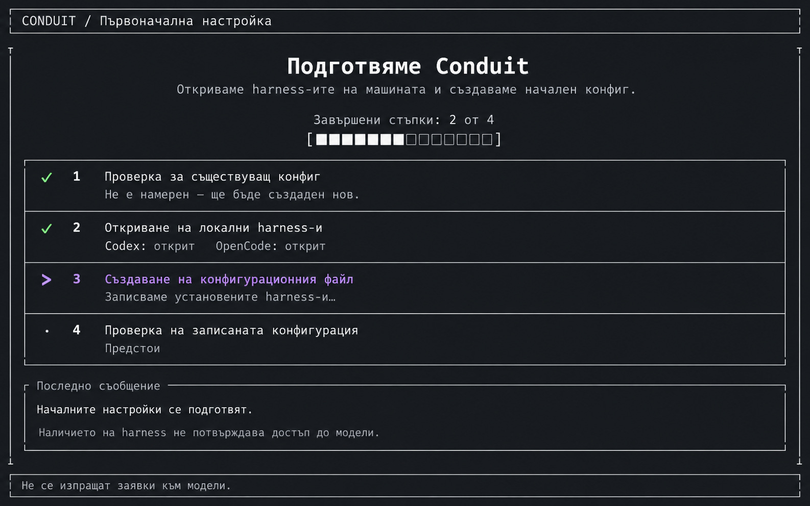

## 01 — Първо стартиране без проекти

Актуална версия v2: welcome/empty state след успешно зареждане, а не boot splash. Посланието представя Conduit като помощ за реализиране на идея или проект чрез оркестриране на агенти от различни harness-и. Не споменава конкретна research роля. Основното действие остава добавяне на проект. Codex и OpenCode са примери за harness-и, не индикатор за свързани или настроени услуги.

Предишната [версия v1](01-first-launch.png) е запазена за история и е заменена от v2. Продуктовата посока на текста е уточнена от потребителя; точният текст и оформление остават макет за преглед.

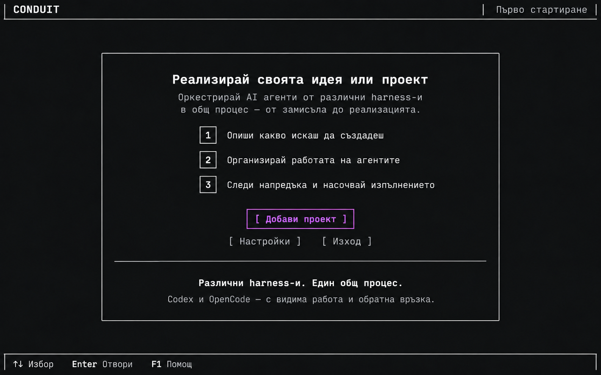

## 02 — Начален екран с избран проект

Проектите са вляво; вдясно има идеи/spec документи, етап и нужда от внимание. Избрана идея показва кратък контекст и действия за документ или разговор. Нова идея и отваряне на съществуващ spec са различни входове. Редовете и статусите са примерни данни, не договорени enums или доказателство за фонова работа.

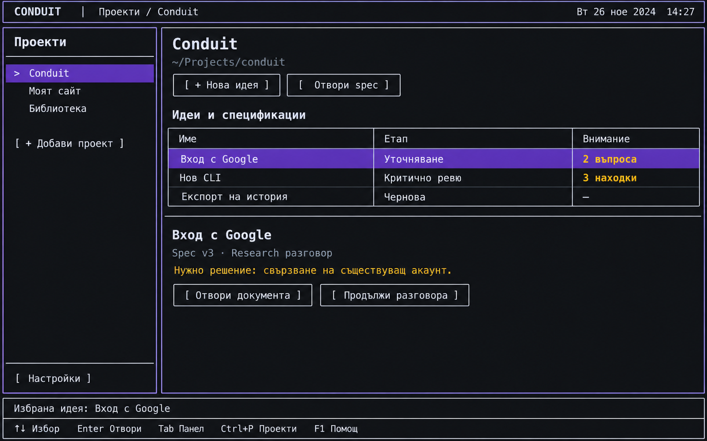

## Въпроси, които екраните изваждат

- Добавяме само съществуваща папка или предлагаме създаване/клониране? Какво става при липсващ или дублиран път?
- „Отвори spec“ редактира оригинала или импортира копие? Как пазим външните редакции?
- При следващ старт отваряме последния проект или общ списък? Какво възстановяваме?
- Как настройваме липсващ harness/model при първо използване на агент?
- Как изглеждат тесен терминал, дълги имена, повече проекти, празен избран проект и грешка при зареждане?
- Какво означават етапите и индикаторите за внимание, включително от друг проект?

## Граници на изображенията

Широките макети не определят точен терминален размер в колони/редове. Клавишите са предложения. Генерираният home макет съдържа примерна дата/час, различни размери на букви и няколко лилави рамки: това не въвежда часовник, пропорционална типография или едновременен keyboard focus като изисквания. Реалният TUI трябва да има ясен единствен фокус, моноширинна клетъчна подредба и отделно означена селекция.

За визуален одит първо се одобряват целевият екран и състоянието. Skill-ът сравнява реална capture с този ориентир, като отчита клетъчната геометрия и одобрените разлики. Не изисква pixel-perfect възпроизвеждане на генеративни артефакти.

## 03 — Добавяне на локален проект

Предложение: избор на съществуваща папка и име за списъка. Прегледът показва примерна намерена Git директория; самото добавяне не стартира агент. Поддръжка на папка без Git, клониране, създаване, дублирани/липсващи пътища и отказ за достъп остават за решение. Не приемаме наличието на Git като задължително правило само заради примера.

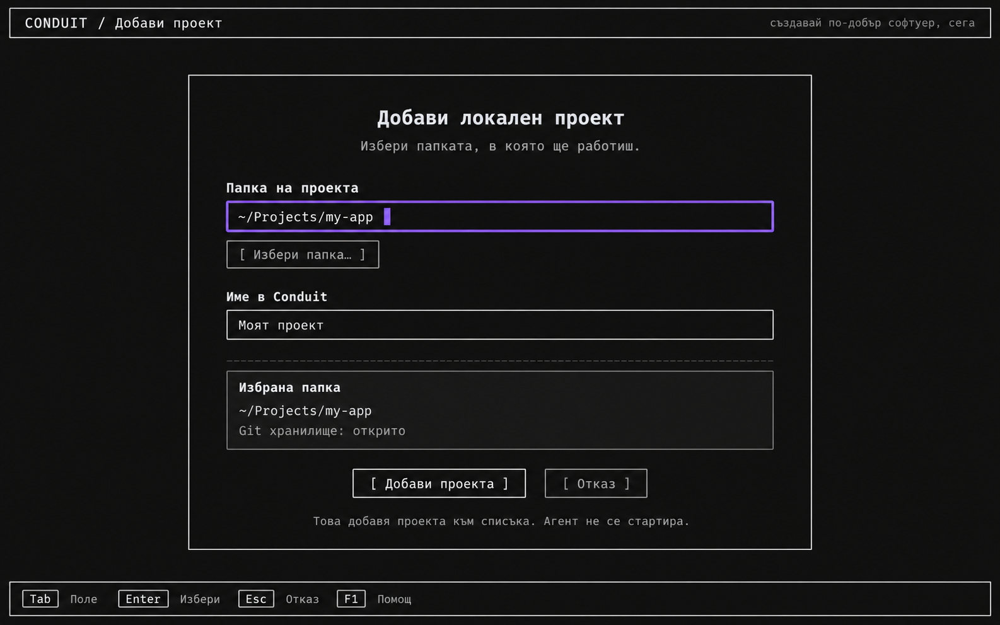

## 04 — Нова идея: директен редактор със скриваем чат

Актуална версия v2 по решение на потребителя: „Нова идея“ отваря директно редактора на spec със страничен чат. Отделната форма и предварителният избор между самостоятелно писане и разговор отпадат. Чатът може да се скрива и показва със запазен разговор; скриването освобождава място за документа. Самото показване не стартира inference.

Има бутон „Запази“ и се предвижда автоматичен запис на няколко секунди. Точният интервал, default режимът и дали shortcut превключва автоматичния запис или записва веднага чакат уточнение от потребителя. Надписът „Автозапис“ в макета е място за управление/статус, не доказателство за включен режим. Реалният екран трябва ясно да показва включен/изключен режим и грешка при запис.

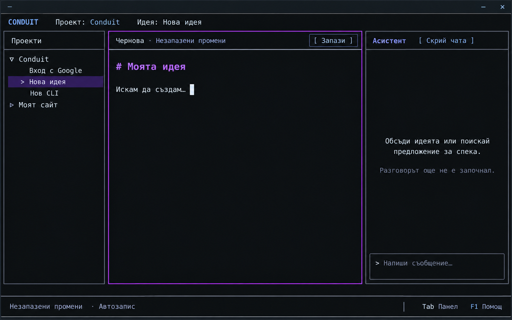

Старата форма е [архивирана като заменена](archive/04-new-idea-form-superseded.png) и не участва в текущия flow.

## 05 — Отваряне на spec

Избор на Markdown файл с предварителен преглед. „Продължи“ тук още не означава импорт или редакция на оригинала: това решение е отворено и трябва да стане ясно преди запис. Сценарии за допълване: липсващ/нечетим файл, файл извън проекта, голям документ, празен файл и външни редакции.

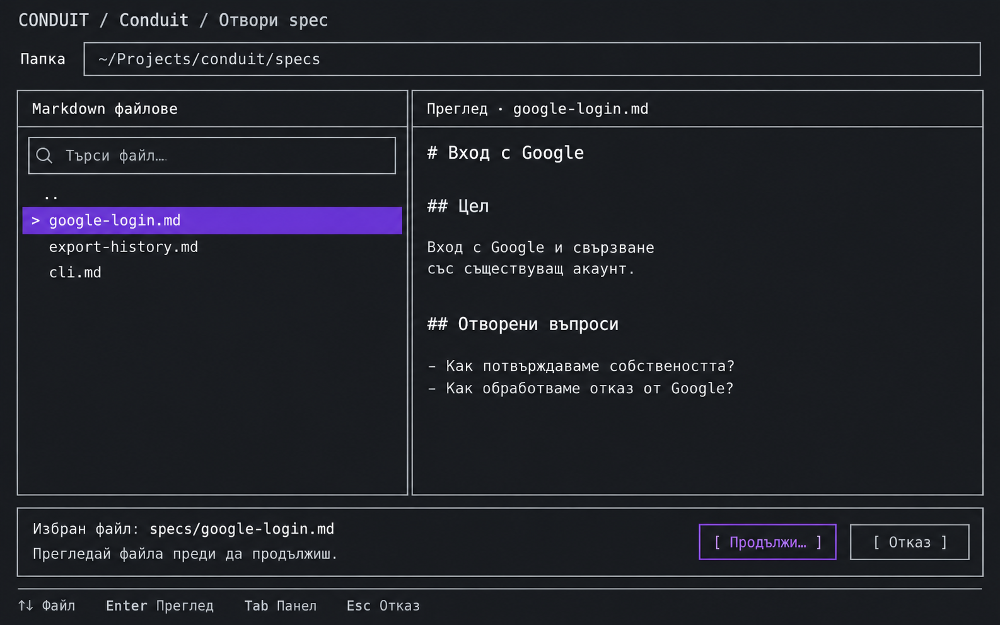

## Връзка между екраните

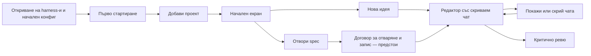

Това е предложен навигационен flow, не разрешение за имплементация. Отварянето на spec трябва да допуска и редакция без агент; стрелката към разговора обозначава един възможен път. Следващи макети за обсъждане: избор на harness/model, редактор със скрит чат, настройване при липсващ harness, diff в документния панел и действия в чата, тесен терминал и error states.

Генеративни детайли в тази група (примерни дати/версия, декоративен слоган, resize маркер и виолетов бутон едновременно със селекция) не са изисквания. В реалния TUI фокусът трябва да е еднозначен и взаимодействията да следват съгласувания договор.

## 06 — Настройки: роли

Макет на настройките върху проверените legacy полета: harness/model/effort/mode, инструкции, обхват и зависимости. Показва произход на ефективните стойности. Разделянето на „Роли“, „Harness-и“, „Проект“ е предложение за по-ясна навигация. [Инвентар и граници](../contracts/role-settings.md).

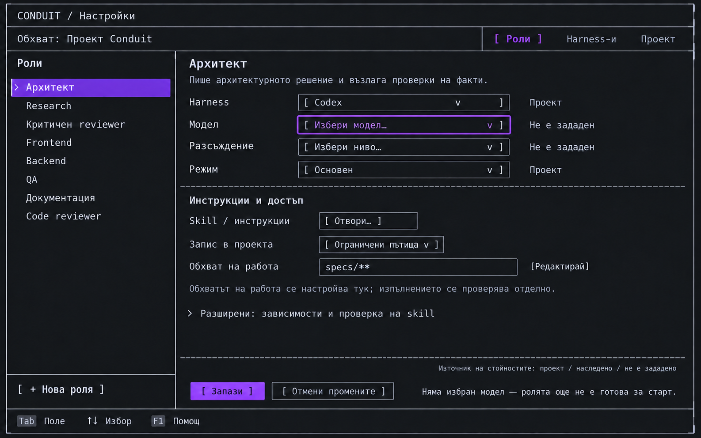

Табовете „Harness-и“ и „Проект“ са показани в макети 07–08 по-долу. Примерното назначение Codex и specs/** не са одобрени defaults; формулировката „Ограничени пътища“ изисква отделен enforcement договор. Основната виолетова селекция/бутон в изображението не означава няколко keyboard focus-а.

## 07 — Настройки на harness-и

Отделни наблюдения за инсталация, достъп и модел каталог. Примерът включва намерен Codex с непроверен достъп и липсващ OpenCode; това не е проверка на текущата машина. Предложени действия: повторна проверка, зареждане на metadata и указване на executable. Не се правят автоматично инсталация, inference или fallback. Local/remote ефектите на metadata операциите предстоят в договора.

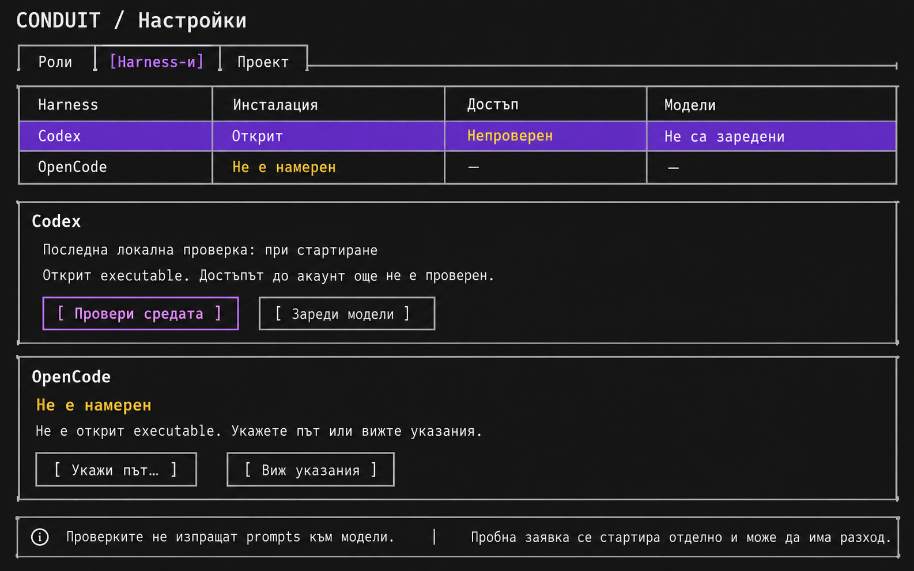

## 08 — Настройки на проект

Директории и срокове за съхранение върху legacy полетата. Пътищата и стойностите 7/30 дни са примерни, не одобрени Go defaults. Промяната на настройка не разрешава мълчаливо преместване/изтриване на данни. Валидация, migration и cleanup policy се съгласуват отделно.

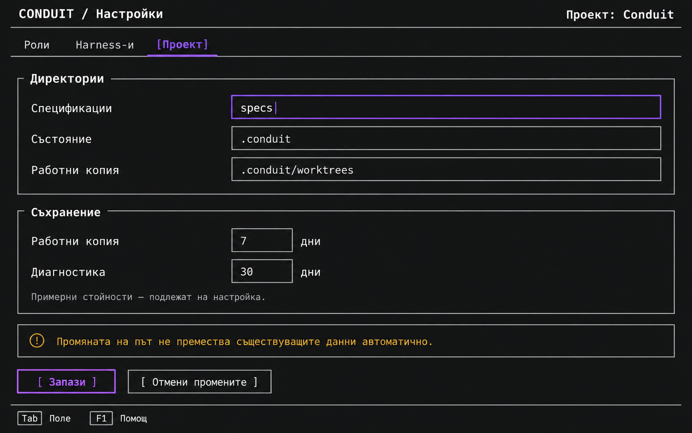

## 09 — Включване на локална памет

Одобрено: Engram се изтегля при включване от потребителя. Екранът обяснява ползата, локалното съхранение и показва изтегляне, проверка, стартиране и готовност. [Договор](../contracts/project-memory.md#изтегляне-при-включване--одобрено-ux-изискване).

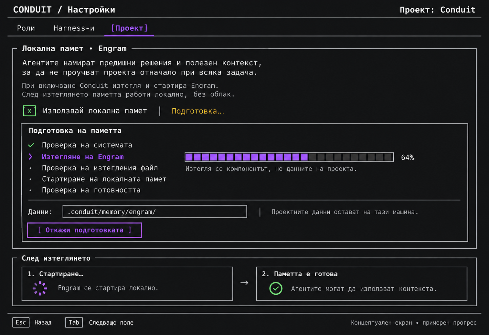

Основният екран показва примерен download. Долните карета са storyboard на следващи състояния, не едновременна готовност. Процентът и декоративните символи не са runtime evidence; реалният TUI използва терминално съвместими индикатори и един keyboard focus. Failure/retry/cancel състоянията са описани в договора, но още нямат отделен макет. Създаден с вградения imagegen инструмент; [точен prompt](09-memory-setup.prompt.txt).

## GUI варианти

[Първите шест GUI състояния](gui/README.md) следват същите application договори, с визуална посока templUI 2.0 beta. Макети за преглед, не реализиран интерфейс.
