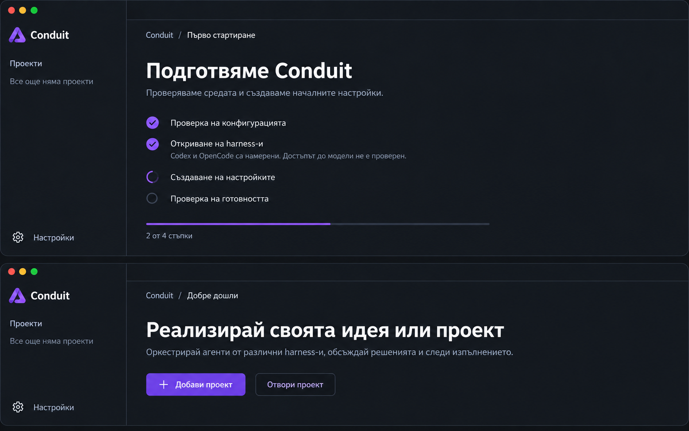
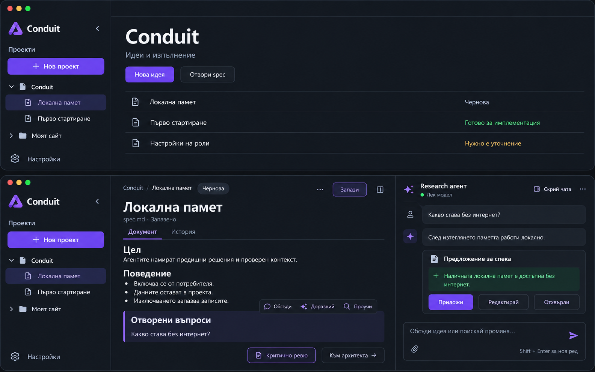
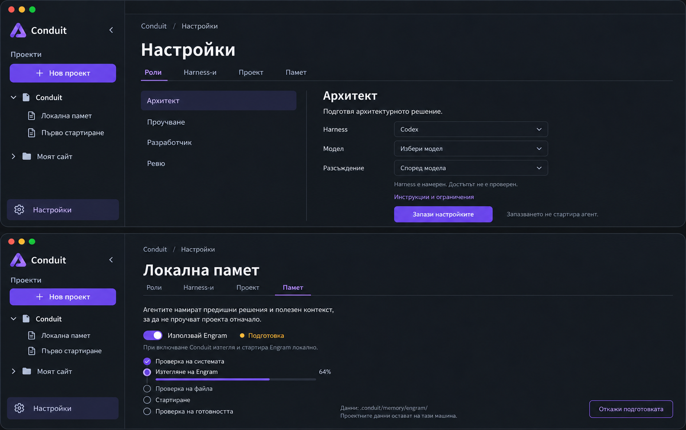

# GUI — начални flows

Дизайн макети за преглед, генерирани с вградения imagegen инструмент. Не са screenshots на работещ templUI интерфейс и не доказват WebView съвместимост. Точните prompts са до изображенията.

Потребителят прие посоката shadcn-templ / templUI 2.0 beta с фиксиране на beta.10 и compatibility проверка преди GUI реализация. Общата бизнес логика остава независима от GUI и TUI.

## 01–02: Първо стартиране и welcome

Откриване на harness-и преди генериране на настройки, реален прогрес, без inference; welcome представя реализиране на идеи с различни harness-и. Примерните намерени инструменти не са факт за машината. Реалната обвивка използва native контроли за съответната платформа. Прогресът е илюстративен, не измерено време.

## 03–04: Проект и редактор с чат

Превключване на проекти, нова идея, отваряне на spec и редактор със скриваем чат. Приложи/редактирай/отхвърли остават в чата. Запис не означава приемане на предложение. Критичното ревю е опционално; преминаването към архитекта не стартира имплементация.

## 05–06: Настройки и локална памет

Настройки на роля без автоматичен избор на модел; открит harness не означава проверен достъп. Engram се изтегля при включване. Подготовка и готовност са различни състояния. Отделният таб Памет е предложение за GUI организация на проектната настройка, не глобален scope. Готовност се отчита след успешна проверка, не само след стартиране.

Това са първите шест GUI състояния. Отделни макети за добавяне/отваряне на проект, критично ревю, архитект, изпълнение, резултат и error states предстоят; не се счита за пълно GUI покритие на TUI галерията.

## Визуална посока — ревизия 2

По изрично предпочитание на потребителя основният [визуален ориентир](visual-reference.png) е първият документен GUI макет: общо дърво с проекти и задачи вляво, свободен документен панел, скриваем чат вдясно, малко рамки и сдържан лилав акцент. Активните изображения по-горе са v2, генерирани с imagegen по този ориентир; първите PNG и prompts са запазени като исторически версии. Функционалните договори остават същите.

Генеративни отклонения: селекцията на документ в горния project overview не определя navigation state; действителната селекция следва отворения изглед. Зелената точка при research агента е илюстративна, не доказателство за достъп/работа. Процентите в изображенията са примерни. Текст, размери, контраст, фокус и native контроли се проверяват върху реалната имплементация.
